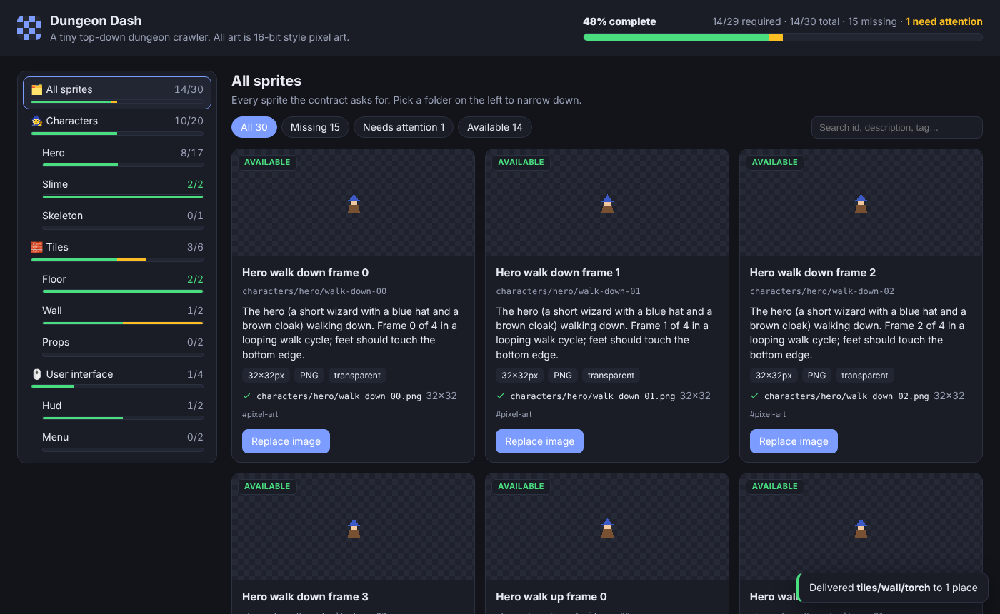

# Image Administration

A **standard** (the *Sprite Contract*) plus a small tool for it:

* Your application declares the images it needs in YAML/JSON files: a description of each, size and format rules, and **where each file must be delivered**.
* `sprite-admin` reads those files, shows what is **missing / available / invalid** with progress bars per folder, and lets you **upload** images.
  Uploads are validated against the contract and copied to every target path it names.

No image editor, no database, no build step. The app only loads files from the paths it declared; the file system is the source of truth.



## Quick start

```bash
npm install
npm run demo                              # opens the Dungeon Dash example at http://127.0.0.1:4870
```

For your own project:

```bash
node bin/sprite-admin.js init ../my-app   # scaffolds ../my-app/sprites.contract.yml
# edit it (or have an AI write it with docs/AI_AUTHORING_GUIDE.md), then:
node bin/sprite-admin.js validate ../my-app
node bin/sprite-admin.js serve ../my-app  # --port 4870 --host 127.0.0.1
```

(`npm link` gives you a global `sprite-admin` command.)

## What you get

* **Folder tree** derived from sprite ids (`characters/hero/idle`), with a progress bar per folder and overall.
* **Cards** for each sprite: thumbnail on a checkerboard, description, requirement chips (`32×32px · PNG · transparent`), every target with ✓ / ○ / ✕.
* **Fit to frame**: when an image is not exactly the size a sprite requires, a small editor opens (scale, move, fit/fill/stretch, crisp-pixel or smooth) and uploads the result at the exact size. It runs in the browser, so no extra dependencies.
* **Upload** per card (button or drag-and-drop) or **bulk drop** of many files, auto-matched by file name.
* **Validation before delivery**: size, aspect, format, transparency, file size, real file type. Rejections explain exactly why and write nothing.
* **Multi-target delivery**: one upload is written to all target paths. Overwritten files are backed up to `<root>/.sprite-admin/backups/`.
* **Live**: the contract is re-read continuously, so edits (by you or an AI) appear within seconds.
* **CLI for AIs and CI**: `validate`, `status --json`, `status --missing`, `status --check`.

## The contract in 20 lines

```yaml
contract: "1.0"
project: { name: Dungeon Dash, description: "16-bit pixel art, top-down.", root: game }
include: [contracts/*.yml, contracts/*.json]       # several files, YAML and JSON mixed
defaults: { spec: { alpha: required, formats: [png] } }
folders:
  characters: { title: Characters, icon: "🧙", defaults: { spec: { width: 32, height: 32 } } }
sprites:
  - id: characters/hero/walk-{dir}-{frame:02}      # matrix: 4 x 4 = 16 sprites
    description: The hero (short wizard, blue hat, brown cloak) walking {dir}, frame {frame} of 4.
    matrix: { dir: [down, up, left, right], frame: "0..3" }
    target: characters/hero/walk_{dir}_{frame:02}.png
```

| Document | For |
|----------|-----|
| [docs/CONTRACT.md](docs/CONTRACT.md) | The complete specification: every field, inheritance, matrix, targets, diagnostics, report format, HTTP API. |
| [docs/PLUGIN_REWRITE.md](docs/PLUGIN_REWRITE.md) | One-page read-up for (re)writing a plugin against the HTTP API. |
| [docs/PLUGIN_INTEGRATION.md](docs/PLUGIN_INTEGRATION.md) | HTTP API for plugins/other servers: request images, receive uploaded images by webhook, catch up by polling. |
| [docs/AI_AUTHORING_GUIDE.md](docs/AI_AUTHORING_GUIDE.md) | Step-by-step guide and checklist for AI agents/scripts that write or maintain a contract. |
| [schema/sprite-contract.schema.json](schema/sprite-contract.schema.json) | JSON Schema for editor completion/validation of any contract file. |
| [examples/dungeon-dash](examples/dungeon-dash) | A complete, multi-file demo (4 files, 30 sprites, partly filled). |

## Why several files?

A single manifest stays small: project info, shared defaults, and an `include` list. Everything else is split by domain or owner.
A new file dropped into `contracts/` is picked up automatically, and each file can have its own `defaults`, so a tiles file says "16×16, opaque" once.
Because every file is a self-contained document, several people or AI agents can extend the contract in parallel without merge conflicts.

## Commands

```
sprite-admin [serve] [contract] [--port 4870] [--host 127.0.0.1]
sprite-admin validate [contract]            exit 1 on contract errors
sprite-admin status [contract] [--json] [--missing] [--check]
sprite-admin init [dir]
```

## Security notes

The server listens on `127.0.0.1` only by default, rejects foreign `Host` headers (DNS rebinding) and requires an `X-Sprite-Admin` header on writes (CSRF).
Targets can never leave the project root. Do not expose it to untrusted networks: there is no authentication.

## Development

```bash
npm test          # contract loader, image probing, HTTP API end-to-end
npm run demo:reset  # regenerate the demo art
```
